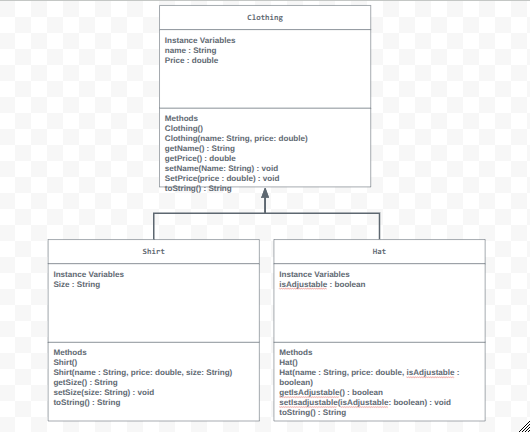

# store-managment-project

# Unit 2 - Store Management Project

## Introduction

You are opening a new business in your community! Businesses often need programs to manage the products and services they offer and track orders and requests from customers. Your goal is to create a store management system for your business.

## Requirements

Use your knowledge of object-oriented programming and class structure and design to create your store management system:
- **Create a class hierarchy** – Develop a superclass that represents a product or service your business offers and one or more subclasses that extend the superclass to represent more specific types of products or services.
- **Declare instance variables** – Declare instance variables in the superclass that are shared with the subclasses and instance variables in the subclasses that are not shared with the superclass.
- **Write constructors** – Write no-argument and parameterized constructors in the superclass and subclasses. Subclass constructors use the super keyword to call the superclass constructor.
- **Implement accessor and mutator methods** – Write accessor and mutator methods for instance variables that should be accessible and/or modifiable from outside of the class.
- **Implement a toString() method** – Write toString() methods in the superclass and subclasses that return information about the state of an object.

## UML Diagram

Embed your UML Diagram here. Upload the image of your UML Diagram to your repo, then use Markdown to insert your image here:

## Description

1. I chose to create a digital Clothing Store because appareal inventory has clear categories and sitinct physical attributes that translate perfectly into object oriented programming.

2. This project directly ocnnects to STEAM principles. I utilized software technology and engineering to make my code and organize the different clothing items. I used math to count the items and calculate prices. I also used Science when I had to test my code and fix bugs that broke it.

3. I showed important SLO's by finishig this store. I learned how to build a smart project using Java coding rules like inheritance. I used my problem solving skills to turn a real life clothing shop into a computer game. i also wrote clean code that is super easy to read.
